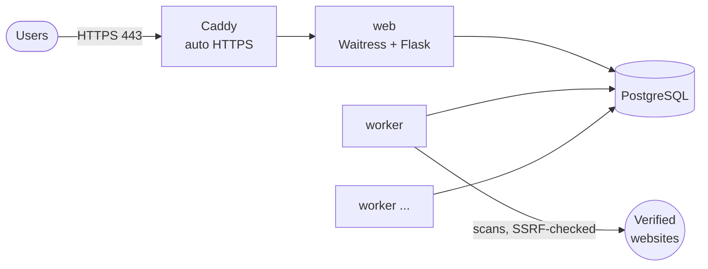

# Deploying WebVuln Scanner for other people (public mode)

This guide puts the scanner on a server so other people can sign up and scan **their own** websites.

> **Status:** the Docker / PostgreSQL / Caddy setup in this guide has **not been tested yet**. Public mode was
> tested with the automated tests and with `serve.py` + `worker.py` on SQLite. Do the
> "Try it on your own PC first" section below before putting it on the internet.
If you only want to use it on your own computer, you don't need any of this: `python app.py` is enough.

---

## What changes in public mode

| | Local mode (`python app.py`) | Public mode (Docker) |
|---|---|---|
| Who can scan what | Allowlisted hosts (localhost) or verified websites | **Only websites the user has proven they own** |
| Internal addresses (127.0.0.1, 10.x, 192.168.x ...) | Allowed if allowlisted | **Always blocked**, checked on every connection |
| Limits | Your own choice | Max 50 pages, 1000 requests, 0.2 s delay, 1 scan at a time, 5 per day |
| Where scans run | A thread inside the web app | Separate `worker` containers |
| Database | SQLite file | PostgreSQL |
| Web server | Flask development server | Waitress behind Caddy (HTTPS) |
| Old scans | Kept | Deleted after 30 days |

The test lab (`test_lab/`) and the tests are **not** copied into the Docker image (see `.dockerignore`).

## Architecture



The web app never scans by itself. It puts a scan in the database queue, and a worker picks it up.

---

## What you need

- A Linux server (VPS) with at least 1 GB RAM, for example from Hetzner, DigitalOcean or Linode
  (about $5-10 a month). Free hosting usually stops long-running workers.
- A domain name, with an **A record** pointing to the server's IP address.
- Docker installed on the server (`curl -fsSL https://get.docker.com | sh`).
- Ports 80 and 443 open in the server firewall.

## Step by step

**1. Get the code on the server**
```bash
git clone https://github.com/Aman7608/WebVuln-Scanner.git
cd WebVuln-Scanner
```

**2. Create the `.env` file**
```bash
cp .env.example .env
python3 -c "import secrets; print(secrets.token_hex(32))"   # run twice: one for the secret key, one for the DB password
nano .env
```
Fill in `WEBVULN_DOMAIN`, `WEBVULN_PUBLIC_URL`, `WEBVULN_SECRET_KEY` and `POSTGRES_PASSWORD`.
**Never commit `.env`** (it is in `.gitignore`).

**3. Start everything**
```bash
docker compose up -d --build
docker compose ps          # all four services should be "running"
docker compose logs -f web # Ctrl+C to stop watching
```
Caddy gets a Let's Encrypt certificate automatically on the first visit.

**4. Create the admin account at once**
Open `https://your-domain/register`. The **first** account becomes the admin. Create it straight away,
before anyone else can. If you don't want strangers to sign up, set `WEBVULN_REGISTRATION=0` in `.env`
and run `docker compose up -d` again.

**5. Scan your first website**
Go to **My websites**, add your domain, publish the verification file or DNS record, press
**Check now**, and then start a scan.

## Everyday tasks

| Task | Command |
|---|---|
| More scans at once | `docker compose up -d --scale worker=3` |
| Update to the newest code | `git pull && docker compose up -d --build` |
| See logs | `docker compose logs -f web worker` |
| Back up the database | `docker compose exec db pg_dump -U webvuln webvuln > backup.sql` |
| Stop everything | `docker compose down` (your data stays in the volumes) |

## Try it on your own PC first

Set these in `.env`:
```
WEBVULN_DOMAIN=localhost
WEBVULN_PUBLIC_URL=https://localhost:8443
WEBVULN_HTTP_PORT=8088
WEBVULN_HTTPS_PORT=8443
```
Then run `docker compose up -d --build` and open https://localhost:8443. Caddy uses its own
local certificate, so the browser shows a warning you can accept. Remember: in public mode you can't scan
`localhost` or the test lab. That's the point of public mode.

## Security checklist before you go live

- [ ] `.env` has a long random `WEBVULN_SECRET_KEY` and `POSTGRES_PASSWORD`
- [ ] The admin account is created and uses a strong password
- [ ] Only ports 80 and 443 are open (the database has no public port)
- [ ] `WEBVULN_REGISTRATION` is set the way you want
- [ ] Optional: SMTP settings for email notifications
- [ ] You check **Admin → Abuse reports** regularly
- [ ] You have a backup plan for the database

## Your responsibility

Running a public scanner means people can use your server to send test traffic. Ownership verification,
SSRF protection, quotas and the audit log make misuse hard and traceable, but please read the
[terms page](dashboard/templates/terms.html), keep an eye on abuse reports, and delete accounts that break
the rules.
