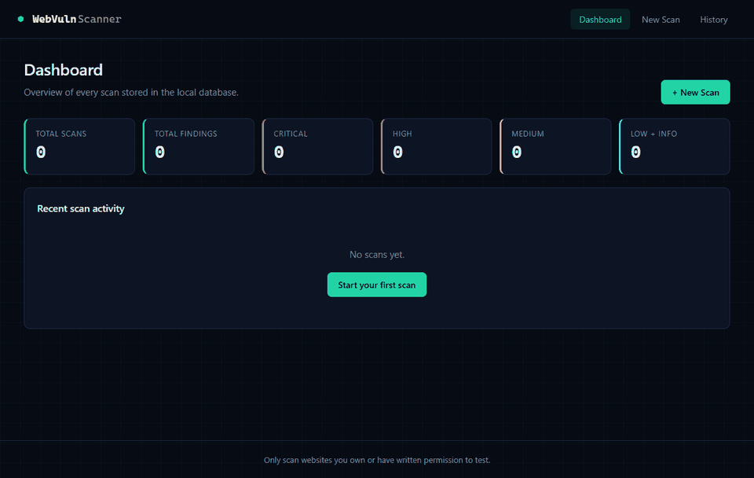
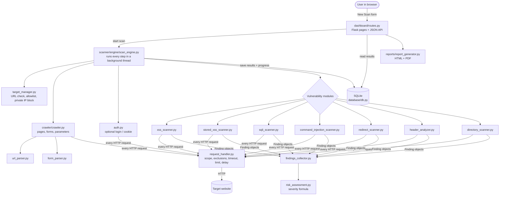
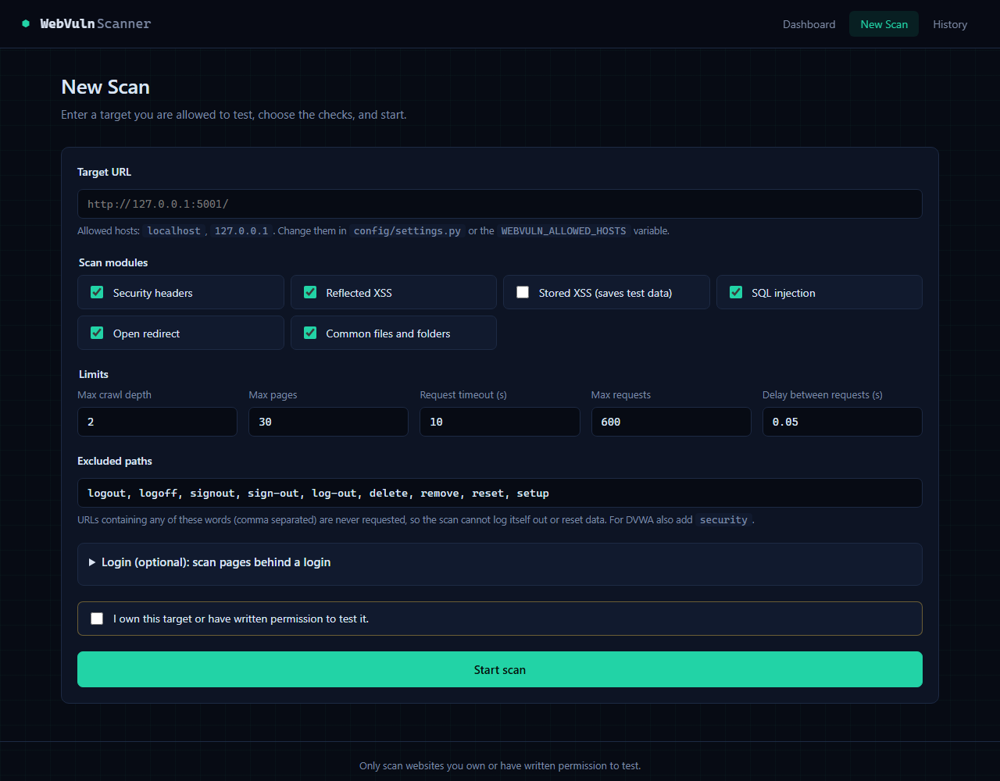
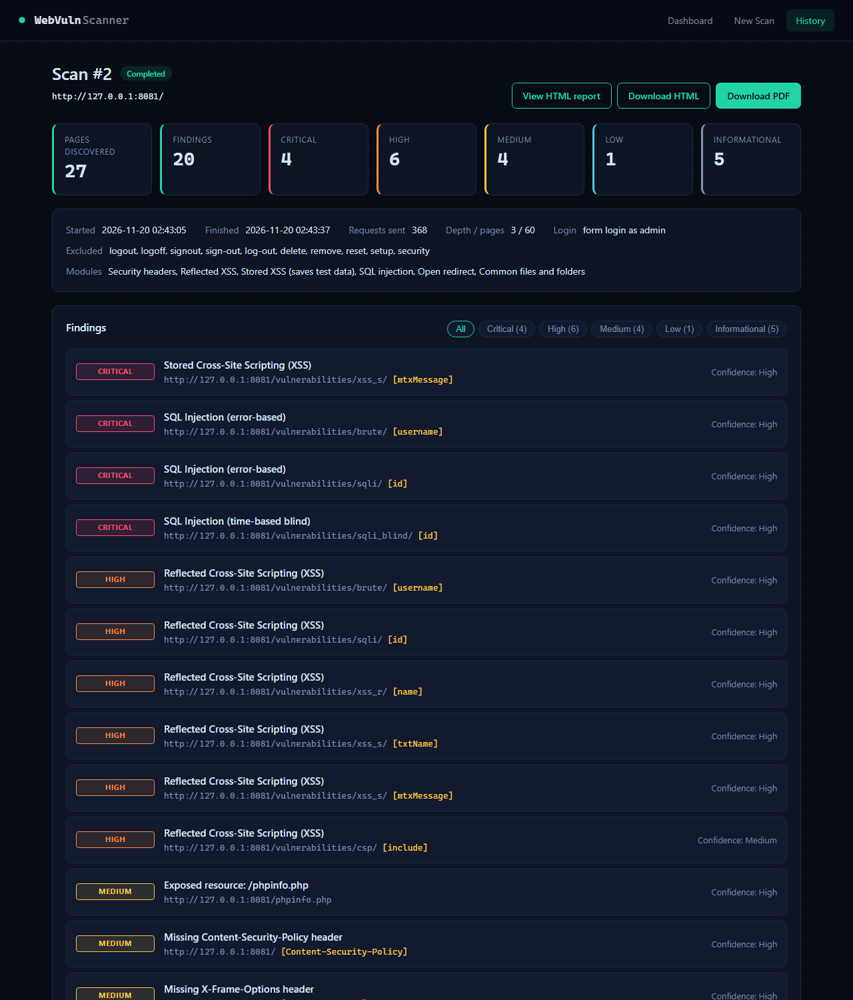
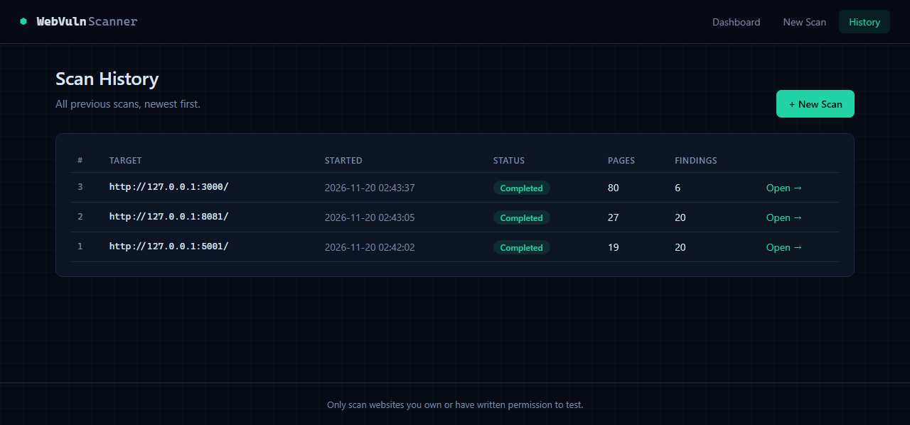
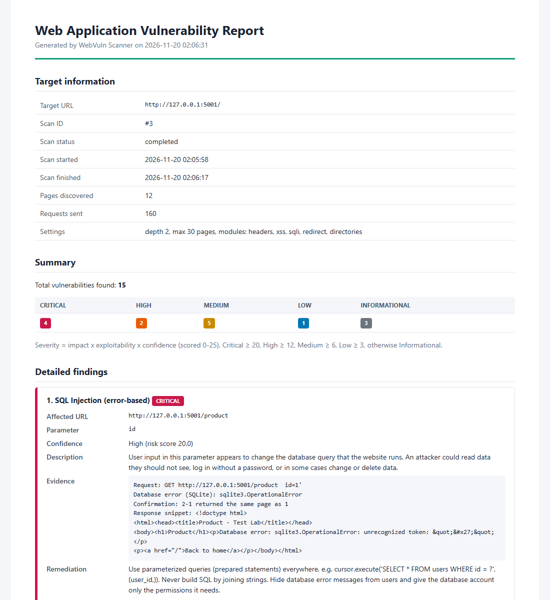

# WebVuln Scanner

[](https://github.com/Aman7608/WebVuln-Scanner/actions/workflows/tests.yml)

A beginner-friendly web application vulnerability scanner written in Python and Flask.

You give it the URL of a website you are allowed to test. It crawls the site, finds the pages, forms and
URL parameters (also API addresses hidden in JavaScript files), and then checks them for common security
problems: reflected and stored XSS, SQL injection (error, boolean and time-based), command injection,
open redirects, missing security headers and exposed files. It can log in first to test pages behind a
login. Everything is saved in a database, shown on a dark web dashboard, and can be exported as HTML,
PDF, JSON or CSV.

It runs in two modes:
- **Local mode** (`python app.py`): on your own computer, for your own apps and the included test lab.
- **Public mode** (Docker): a multi-user service where people sign up, **prove they own a website** and
  scan it. Every connection is protected against SSRF, with quotas, an audit log, an admin area and HTTPS.
  See [DEPLOYMENT.md](DEPLOYMENT.md).

It has been tested against its own vulnerable test lab, **DVWA** and **OWASP Juice Shop**
(see [Results on DVWA and Juice Shop](#results-on-dvwa-and-juice-shop)).

I built this project to learn how scanners like OWASP ZAP work on the inside. It is meant for learning
and for testing your own apps, not for replacing professional tools.



*Demo: a scan of the local test lab with login and stored XSS turned on (about 30 seconds of real time).*

---

## Features

| Module | What it does |
|---|---|
| **Target management** | Validates the URL (http/https only), only allows hosts on an allowlist, blocks private/internal IPs that are not allowlisted, always blocks cloud metadata IPs, and limits timeouts and requests |
| **Web crawler** | Finds pages by following links (same site only), reads forms and input fields, collects URL parameters, skips duplicates, stops at a max depth and max page count |
| **JavaScript endpoint discovery** | Reads the site's `.js` files as text and picks out API paths like `/rest/products/search?q=` (also inside template strings), so single-page apps such as Juice Shop can be tested |
| **Login support** | Logs in through the site's login form (keeps hidden CSRF tokens) or uses a pasted session cookie. Starts crawling from the page after login. The password is never saved |
| **Excluded paths** | URLs containing words like `logout`, `reset` or `delete` are never requested, so the scan can't log itself out or wipe data |
| **Reflected XSS** | Sends a harmless, random marker and checks if it turns into a real HTML tag or attribute. Escaped output is *not* reported |
| **Stored XSS** (opt-in) | Submits a unique marker into every form field, then reloads the pages and checks if a marker now shows up as a real tag |
| **SQL injection detection** | Error-based (database error messages, then confirms), boolean-based ("always true" vs "always false" pages) and time-based blind (`SLEEP`/`pg_sleep`, confirmed twice). Never sends destructive SQL |
| **Command injection detection** | Asks the server's shell to wait (`;sleep 3`, `|sleep 3`, `$(sleep 3)`, Windows `ping -n 4 127.0.0.1`) and confirms the delay twice. Never runs harmful commands |
| **Open redirect detection** | Tests redirect-like parameters with `https://example.com/...` and reads the `Location` header without following it |
| **Security header analyzer** | Checks CSP, X-Frame-Options, HSTS, X-Content-Type-Options, Referrer-Policy (missing **and** weak values) and version leaks in `Server` / `X-Powered-By` |
| **Directory discovery** | Checks about 30 common paths (`/.env`, `/.git/HEAD`, `/admin/`, `/backup/` ...), records every status code, detects "soft 404" pages and hides secrets in the evidence |
| **Findings + risk engine** | Every finding has name, URL, parameter, severity, confidence, description, evidence and fix. Severity comes from a fixed formula, not guesswork |
| **Database** | SQLite stores targets, scans (status, timestamps, settings), discovered URLs and findings |
| **Reports and export** | HTML report (view or download), PDF report (ReportLab), and JSON / CSV export of findings (CSV cells are protected against "CSV injection") |
| **Dashboard** | Totals, severity chart, recent scans, new scan form with live progress and a Cancel button, results with filters, scan history |
| **Safe form handling** | Like a browser, only one submit button is sent per form, and never one named Clear, Delete, Reset or Logout |

**Multi-user and public deployment (version 2)**

| Feature | What it does |
|---|---|
| **User accounts** | Sign up and log in. Passwords are hashed with scrypt, logins are locked after 5 failures, and the first account becomes the admin. Each user only sees their own scans |
| **CSRF protection** | Every form and every JavaScript POST carries a secret token. Other websites can't start scans or delete data in your browser |
| **Ownership verification** | Before scanning, users prove they own a site with a file (`/.well-known/webvuln-verify.txt`) or a DNS TXT record. Required in public mode |
| **SSRF protection** | Every connection is checked *at connect time*. Public mode never reaches 127.0.0.1, 10.x, 192.168.x, cloud metadata and so on, even if a domain switches its IP mid-scan (DNS rebinding) |
| **Scan queue and workers** | Scans wait in the database and separate worker processes run them. They survive restarts and scale with more workers. Login passwords are encrypted while queued and wiped when the scan starts |
| **Quotas** | Public mode: 1 scan at a time, 5 per day, max 50 pages and 1000 requests, at least 0.2 s between requests |
| **Audit log and abuse reports** | Logins, scans and deletions are logged with IP. Anyone can report abuse, and the admin sees reports next to the scans of that website |
| **Admin area** | Overview numbers (users, scans today, waiting/running, failed, open reports). **Users:** block/unblock (logs them out and cancels their scans), make or remove admin, reset password (a one-time temporary password, and the user must pick a new one), delete. **All scans** of every user with a status filter. **Settings:** sign-up, daily quota, scans at once and data retention, changed live without a restart. **Searchable audit log.** The last admin can never be removed |
| **Your data** | Users can delete scans or their whole account. Public mode deletes scans older than 30 days. Optional email when a scan finishes |
| **Production setup** | Waitress web server, PostgreSQL, Caddy with automatic HTTPS, all in `docker-compose.yml` |

---

## Tech stack (and why each one is used)

| Technology | Why |
|---|---|
| **Python 3.12** | Main language, easy to read |
| **Flask** | Small web framework for the dashboard and the JSON API. Easier to learn than Django |
| **Requests** | Sends the HTTP requests. Gives full control over redirects, timeouts and cookies |
| **BeautifulSoup** | Parses HTML to find links and forms, and to check if an XSS marker became a real tag |
| **SQLite** (built into Python) | Local mode: stores everything in one file, no database server needed |
| **PostgreSQL + psycopg** | Public mode: handles many users and several workers at once |
| **Waitress** | Production web server (pure Python, works on Windows and Linux) |
| **Caddy** | Reverse proxy that gets free HTTPS certificates automatically |
| **cryptography (Fernet)** | Encrypts scan login passwords while they wait in the queue |
| **dnspython** | Reads DNS TXT records for ownership verification |
| **Docker Compose** | Starts web, worker, database and Caddy together with one command |
| **ReportLab** | Builds the PDF report in pure Python |
| **Jinja2** (comes with Flask) | HTML templates with auto-escaping, so payloads in evidence can't run in the dashboard or report |
| **HTML / CSS / JavaScript** | The dashboard. Plain JS only, no frameworks |
| **pytest** | Automated tests |

---

## Architecture



**How the modules talk to each other, step by step:**

1. The **New Scan** page sends the form as JSON to `POST /api/scans` (`dashboard/routes.py`).
2. The route asks `target_manager.check_target()` if the URL is valid and allowed. If not, the user sees the reason.
3. A scan row is created in the database and `scan_engine.run_scan()` starts in a **background thread**, so
   the page doesn't freeze.
4. The engine creates one `RequestHandler`. **Every** module sends its requests through it, so the safety
   rules (same site only, timeout, request limit, delay, no automatic redirects) are enforced in one place.
5. The `Crawler` returns the pages and a list of **injection points** (each URL parameter or form, with its normal values).
6. Each vulnerability module tests those injection points and gives `Finding` objects to the `FindingsCollector`.
7. The collector removes duplicates and asks `risk_assessment` for the severity.
8. The engine saves everything to SQLite and updates the progress after each step. The browser checks
   `GET /api/scans/<id>` every second to move the progress bar.
9. The results page and the reports read the saved data back from the database.

### Folder structure

```
WebVuln Scanner/
├── app.py                      # builds the Flask app; "python app.py" = local mode
├── serve.py                    # production web server (Waitress), public mode
├── worker.py                   # scan worker process, public mode
├── config/
│   ├── settings.py             # mode, allowlist, limits, quotas, database URL
│   ├── live_settings.py        # settings the admin can change on the Settings page
│   └── secret_key.py           # secret key for cookies and encryption
├── scanner/
│   ├── target_manager.py       # URL validation, allowlist/ownership, internal address rules, scope
│   ├── ownership.py            # prove you own a website (file or DNS)
│   ├── crawler/
│   │   ├── crawler.py          # breadth-first crawler, builds injection points
│   │   ├── url_parser.py       # normalize URLs, extract links/JS endpoints, read parameters
│   │   └── form_parser.py      # find forms and their fields
│   ├── vulnerabilities/
│   │   ├── xss_scanner.py
│   │   ├── stored_xss_scanner.py
│   │   ├── sqli_scanner.py     # error, boolean and time-based
│   │   ├── command_injection_scanner.py
│   │   ├── timing.py           # shared "make the server wait" logic
│   │   ├── redirect_scanner.py
│   │   ├── header_analyzer.py
│   │   └── directory_scanner.py
│   ├── engine/
│   │   ├── scan_engine.py      # create_scan (checks + queue) and run_scan (all steps)
│   │   ├── worker.py           # takes scans from the queue, housekeeping
│   │   ├── safe_connection.py  # SSRF check on every connection (DNS rebinding safe)
│   │   ├── secret_box.py       # encrypts login secrets while a scan is queued
│   │   ├── notify.py           # optional "scan finished" email
│   │   ├── auth.py             # logging in to the TARGET site (form or cookie)
│   │   └── request_handler.py  # the only place that sends HTTP requests (scope, limits, exclusions)
│   └── analysis/
│       ├── findings_collector.py
│       └── risk_assessment.py
├── database/
│   ├── models.py               # table definitions (users, domains, scans, findings, audit log ...)
│   └── db.py                   # all reads and writes, for SQLite and PostgreSQL
├── reports/
│   ├── report_generator.py     # HTML + PDF
│   └── templates/report.html
├── dashboard/
│   ├── routes.py               # scan pages and JSON API (login required)
│   ├── accounts.py             # sign up, log in, account page
│   ├── domains.py              # "My websites" (ownership)
│   ├── admin.py                # admin area (users, scans, reports, settings, audit), terms, report abuse
│   ├── security.py             # password hashing, CSRF, login_required
│   └── templates/              # all the HTML pages
├── static/css, static/js       # dark theme + progress/filter scripts
├── test_lab/vulnerable_app.py  # deliberately vulnerable site for testing (127.0.0.1 only)
├── tests/                      # pytest test suite (also run by GitHub Actions)
├── .github/workflows/tests.yml # runs the tests on every push
├── Dockerfile, docker-compose.yml, Caddyfile, .env.example   # public deployment
├── DEPLOYMENT.md               # how to run it for other people
└── docs/                       # demo.gif, screenshots, interview notes
```

**Changes from the first plan:** I added `test_lab/` (a local vulnerable site, so testing never needs the
internet or Docker), `tests/conftest.py` (starts the lab automatically during tests), and extra test files
for redirects, directories, risk, database and the dashboard.

---

## How the vulnerabilities are detected

**Reflected XSS.** For each parameter the scanner makes a random marker like `wvsk3j9qz` and sends
`wvsk3j9qz"'><wvsk3j9qzx>`. The made-up tag `<wvsk3j9qzx>` does nothing, even if it gets through. Then
BeautifulSoup parses the response:
- If the tag exists as a **real element**, the page lets us inject HTML: **High** confidence.
- If the payload is unencoded inside a `<script>` block: **Medium**.
- If it was escaped (`&lt;wvs...`) or not reflected at all: **no finding**. This is how simple reflection is
  told apart from injectable output, and it cuts out most false positives.

A second payload, `marker" markera="1`, checks if a quote can break out of an HTML attribute.

**Stored XSS (opt-in).** Each form field gets its own marker, for example `wvsab12cd"'><wvsab12cdx>`.
After all forms are sent, the crawled pages are loaded again *without* any test input. If a marker now
appears as a real tag, the site saved it and shows it to every visitor. This module is off by default,
because it really saves data (like a guestbook entry) on the site.

**SQL injection.**
- *Error-based:* add `'` to the value. If a database error appears (MySQL, PostgreSQL, SQLite, MSSQL and
  Oracle patterns) that wasn't on the normal page, confirm it: `''` (an escaped quote) should make the error
  go away, or for numbers `2-1` should give the same page as `1`. Confirmed = **High**, not confirmed = **Medium**.
- *Boolean-based:* compare the normal page with `1 AND 1=1` (always true) and `1 AND 1=2` (always false).
  True looks normal and false looks different: **Medium**. The page is loaded twice first, so pages that
  change on their own are skipped.
- *Time-based blind:* used when the page looks the same whatever happens (blind SQLi). The scanner sends
  `1 AND SLEEP(3)` (MySQL) or `1 AND 1=(SELECT 1 FROM PG_SLEEP(3))` (PostgreSQL). It reports only if the
  page is about 3 s slower, the same payload with `SLEEP(0)` is fast again, and a second slow try is slow
  too. That last check rules out a slow network.
- Only read-only test inputs are used. No `DROP`, `DELETE`, `UPDATE`, `INSERT` or stacked queries.

**Open redirect.** Only parameters with redirect-style names (`url`, `next`, `redirect`, `goto` ...) or
URL-looking values are tested, with `https://example.com/wvs-redirect-check` and `//example.com/...`. The
scanner never follows the redirect. It only reads the `Location` header (or a meta refresh tag).

**Security headers.** One normal response is read and each header is checked for being missing *or* weak:
for example CSP with `'unsafe-inline'`, an HSTS `max-age` under 180 days, or a `Referrer-Policy` of `unsafe-url`.

**Directory discovery.** First a random path that can't exist is requested, to learn what the site's
"not found" page looks like. Then about 30 common paths are checked. Sensitive files must have the right
content too (a real `.git/HEAD` starts with `ref:`), and secrets in the evidence are replaced with `****`.

### Risk assessment (how severity is decided)

```
score = impact (1-5) x exploitability (1-5) x confidence factor (High 1.0, Medium 0.8, Low 0.6)

score >= 20  Critical      score >= 12  High      score >= 6  Medium      score >= 3  Low      else  Informational
```

The impact and exploitability numbers for each bug type are listed in
`scanner/analysis/risk_assessment.py`. For example, SQL injection is 5 x 4 = 20 (Critical at High
confidence) and an open redirect is 3 x 3 = 9 (Medium). Lower confidence can only lower the severity.

---

## Installation

You need **Python 3.10+** and **Git**.

```powershell
git clone https://github.com/Aman7608/WebVuln-Scanner.git
cd WebVuln-Scanner
python -m venv venv
venv\Scripts\activate          # Windows
# source venv/bin/activate     # Linux / macOS
pip install -r requirements.txt
```

## Usage

**1. Start the vulnerable test lab** (optional, but great for a demo). In a terminal:

```powershell
python -m test_lab.vulnerable_app
```

It runs at http://127.0.0.1:5001 and listens **only on your own computer**.

**2. Start the scanner dashboard** in a second terminal:

```powershell
python app.py
```

Open http://127.0.0.1:5000 and click **Sign up** to create your account. The first account becomes the
admin, and any scans from version 1 are moved into it. Then go to **New Scan**, enter
`http://127.0.0.1:5001/`, tick the authorization box and press **Start scan**. The scan waits in the
queue for a moment, and a worker inside the app runs it. When it finishes you are taken to the results,
where you can open the HTML report or download the PDF.

> **Tip (Windows):** type `127.0.0.1` instead of `localhost`. Windows tries IPv6 (`::1`) first for
> `localhost`, and the lab only listens on IPv4, so each request waits for the IPv6 attempt to fail and
> the scan becomes very slow.

**Scanning other targets you own.** Only hosts on the allowlist can be scanned. By default that is
`localhost` and `127.0.0.1`. To add one, set an environment variable before starting the app:

```powershell
$env:WEBVULN_ALLOWED_HOSTS = "localhost,127.0.0.1,myapp.test"
python app.py
```

If an allowlisted name points to a private IP (like `10.0.0.5`), you must allowlist that IP too. Cloud
metadata addresses (`169.254.169.254`) are always blocked.

**Scanning a site behind a login.** Open the *Login (optional)* box on the New Scan page and enter the
login page URL plus a **test** username and password, or paste a session cookie copied from your browser.
For the test lab, use `http://127.0.0.1:5001/account/login` with `tester` / `lab-password`.

**Scanning a real website you own.** Instead of editing the allowlist, go to **My websites**, add your
domain, and prove ownership with the file or DNS record shown there.

**Running it for other people.** Use public mode with Docker. The full guide is in
[DEPLOYMENT.md](DEPLOYMENT.md):

```bash
cp .env.example .env      # fill in your domain and secrets
docker compose up -d --build
```

---

## Results on DVWA and Juice Shop

Both run locally in Docker. They only listen on `127.0.0.1`, so nobody else on your network can reach them.

```powershell
docker run -d --name wvs-juice -p 127.0.0.1:3000:3000 bkimminich/juice-shop
docker run -d --name wvs-dvwa -p 127.0.0.1:8081:80 vulnerables/web-dvwa
```

**DVWA** (http://127.0.0.1:8081). First open `/setup.php` and click *Create / Reset Database*. Then scan
`http://127.0.0.1:8081/` with:
- Login page `http://127.0.0.1:8081/login.php`, user `admin`, password `password` (DVWA's default test account)
- add `security` to the excluded paths, so the scan doesn't change DVWA's security level halfway through
- Stored XSS ticked

Result (security level *low*, 27 pages, about 400 requests, under a minute), all real DVWA vulnerabilities:

| Severity | Finding | Where |
|---|---|---|
| Critical | SQL injection (error-based) | `/vulnerabilities/sqli/` `id`, `/vulnerabilities/brute/` `username` |
| Critical | SQL injection (time-based blind) | `/vulnerabilities/sqli_blind/` `id` |
| Critical | OS command injection (time-based) | `/vulnerabilities/exec/` `ip` |
| Critical | Stored XSS | `/vulnerabilities/xss_s/` `txtName` and `mtxMessage` |
| High | Reflected XSS | `/vulnerabilities/xss_r/` `name`, `/sqli/` `id`, `/brute/` `username`, `/xss_s/`, `/csp/` `include` |
| Medium | Exposed `phpinfo.php`, missing CSP / X-Frame-Options, plain HTTP | |

Not found (expected): DOM XSS (`/xss_d/`), file inclusion, CSRF and file upload. This scanner has no
checks for those.

> **A bug DVWA helped me find:** the first version sent *every* submit button of a form. DVWA's guestbook
> has "Sign" and "Clear" buttons, so each test also cleared the guestbook and hid the stored XSS in the
> name field. Now only one safe button is sent, like a real browser does.

**Juice Shop** (http://127.0.0.1:3000). Juice Shop is an Angular single-page app, so the normal links only
lead to one page. The JavaScript endpoint discovery found 80 API paths in `main.js`, including
`/rest/products/search?q=`. The scanner reported the well-known **SQL injection in the product search**
(`q=1'` returns `SQLITE_ERROR`) as Critical / High confidence, plus missing CSP and plain HTTP.

---

## Screenshots

| New Scan | Scan Results |
|---|---|
|  |  |

| Scan History | HTML Report |
|---|---|
|  |  |

---

## Testing

```powershell
python -m pytest -v
```

The tests start the vulnerable lab on a random port automatically, so no internet, Docker or manual setup
is needed. They check:

- URL validation, allowlist, private IP and metadata IP blocking, scope check, request limit
- crawling: links, forms, parameters, no duplicates, max depth, max pages, no external links,
  API paths found in JavaScript (normal strings and template strings)
- login with a CSRF-protected form, wrong passwords, cookies, excluded paths (the scan never logs itself
  out), and that the password is never stored in the database, results page or report
- reflected XSS, stored XSS, SQLi (error, boolean, time-based, and in a JSON API), command injection
  and open redirect:
  **detected** on the vulnerable pages and **not reported** on the safe twin pages
- security headers with fake responses (missing, weak, and secure cases)
- directory discovery, status codes and secret hiding
- risk scores and severity levels
- database storage, SQL-injection-safe queries, scan history
- the dashboard pages, API safety checks, a full scan through the API, and the HTML/PDF reports
  (including that payloads are escaped)
- accounts: password hashing, generic login errors, lockout after failed logins, CSRF tokens, safe
  redirect after login, users can't see each other's scans, admin-only pages, account deletion
- admin: blocking logs a user out and stops login, admin rights, the last admin is protected, password
  reset forces a new password, all scans, live settings, the audit search
- ownership verification by file and DNS, and that the check itself can't reach internal addresses
- SSRF protection: every internal IP range blocked in public mode, DNS rebinding blocked, proxies ignored
- the queue and worker: order, one worker per scan, encrypted secrets wiped after use, cancel, stale
  scans, data retention, email notifications
- public mode: ownership required, limits applied, one scan at a time, daily quota, secure cookies, HSTS,
  and that an old version 1 database is upgraded without losing scans

---

## Explaining this project

See [docs/INTERVIEW_NOTES.md](docs/INTERVIEW_NOTES.md): a 30-second pitch, answers to likely interview
questions (how false positives are avoided, why the payloads are safe, how severity works), and a
five-minute demo script.

## Limitations

- **JavaScript is read, not run.** The crawler finds API paths written in `.js` files, but it doesn't run a
  real browser. URLs that are built step by step at runtime, and POST/JSON APIs, are not found. That's why
  only 1 of Juice Shop's many bugs was found.
- **DOM-based XSS is not detected** (that needs a real browser too).
- **Login works with normal login forms and cookies.** Multi-step logins, CAPTCHAs, 2FA and "Sign in with
  Google" style logins are not supported. Use the cookie field for those.
- **Time-based SQLi covers MySQL/MariaDB and PostgreSQL.** SQL Server would need a stacked query, which is
  never sent on purpose. Boolean-based results can still be false positives on unusual pages.
- **Stored XSS** is only checked on pages the crawler visited, and it really writes data, so it's opt-in.
- **Small path list** for directory discovery, on purpose. This is not a brute-forcer.
- **Forms are really submitted** during testing (for example the login and contact forms). On a real
  app this can create log entries, emails or database rows. Only scan test environments.
- If a worker is stopped in the middle of a scan, that scan is marked failed (after 3 minutes without
  progress). It isn't resumed automatically; start it again.
- Ownership verification proves control of a domain at one moment. If a domain changes owner later, the
  old owner stays verified until they remove it.
- **Not tested yet:** the Docker setup (`docker-compose.yml`) and the PostgreSQL code path. Public mode
  itself was tested with the automated tests and by running `serve.py` + `worker.py` on SQLite.
  Try the Docker setup on a test machine before going live (see [DEPLOYMENT.md](DEPLOYMENT.md)).
- Command injection is only detected with timing (`sleep`), so a page that runs the command in the
  background (without waiting) is missed.
- Automated results always need a human to confirm them.

## Future improvements

- Optional headless-browser crawling (for example Playwright) for JavaScript apps and DOM XSS
- Testing JSON/POST APIs found in JavaScript
- Compare two scans of the same target to see what was fixed

---

## Responsible use

**Only scan websites you own or have written permission to test.** Scanning other people's websites
without permission is illegal in many countries (for example under the Computer Fraud and Abuse Act in
the US, the Computer Misuse Act in the UK, and the IT Act 2000 in India). That's why the scanner has an
allowlist, an authorization checkbox, request limits and polite delays. The included test lab is
deliberately insecure and must never be put on the internet.

## License

MIT, see [LICENSE](LICENSE).
